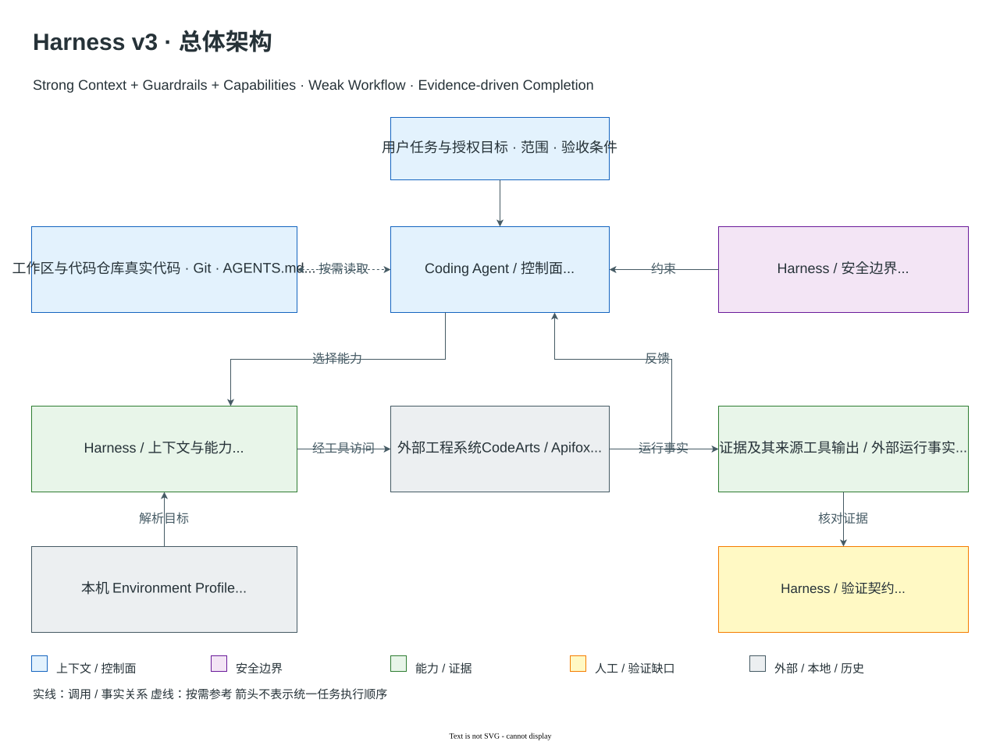
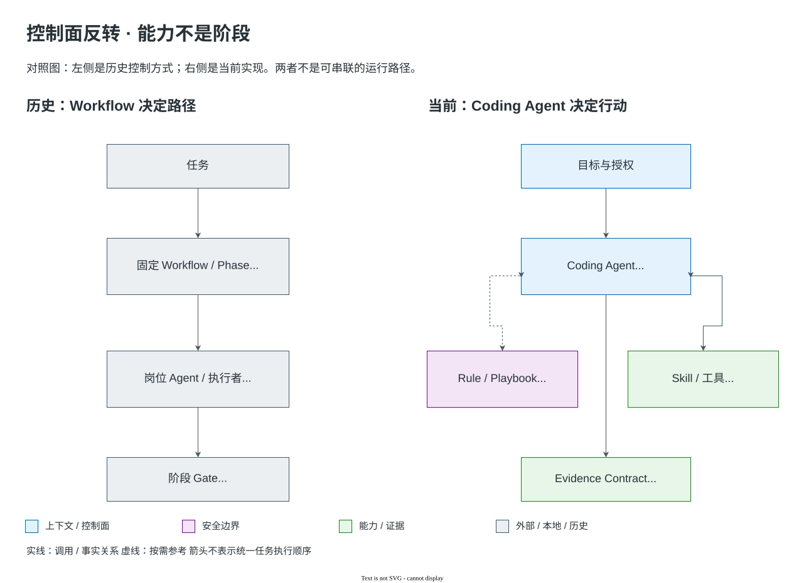
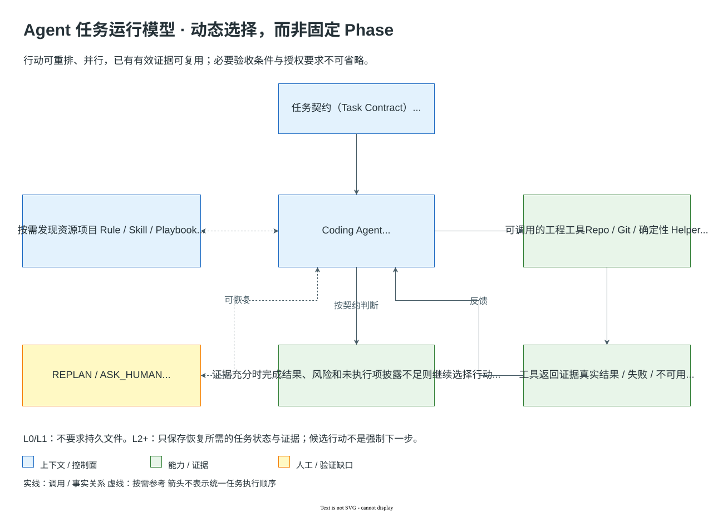
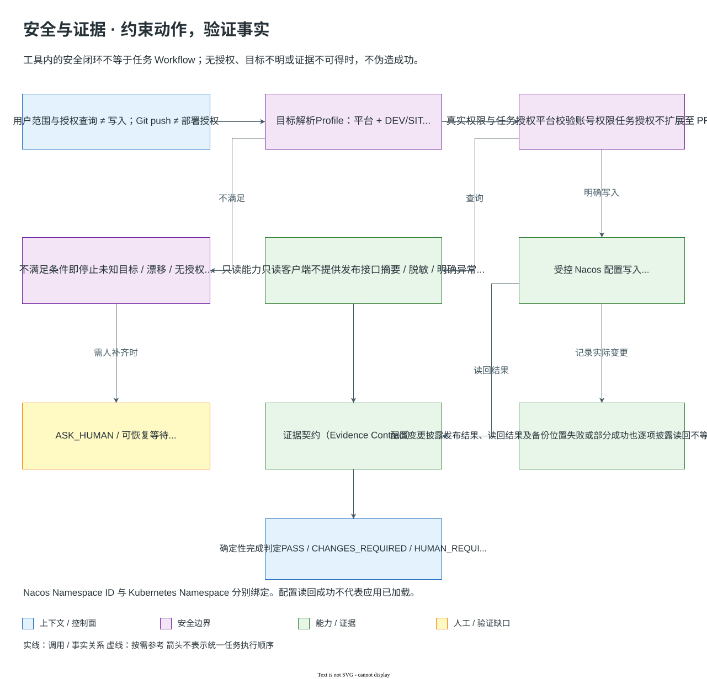
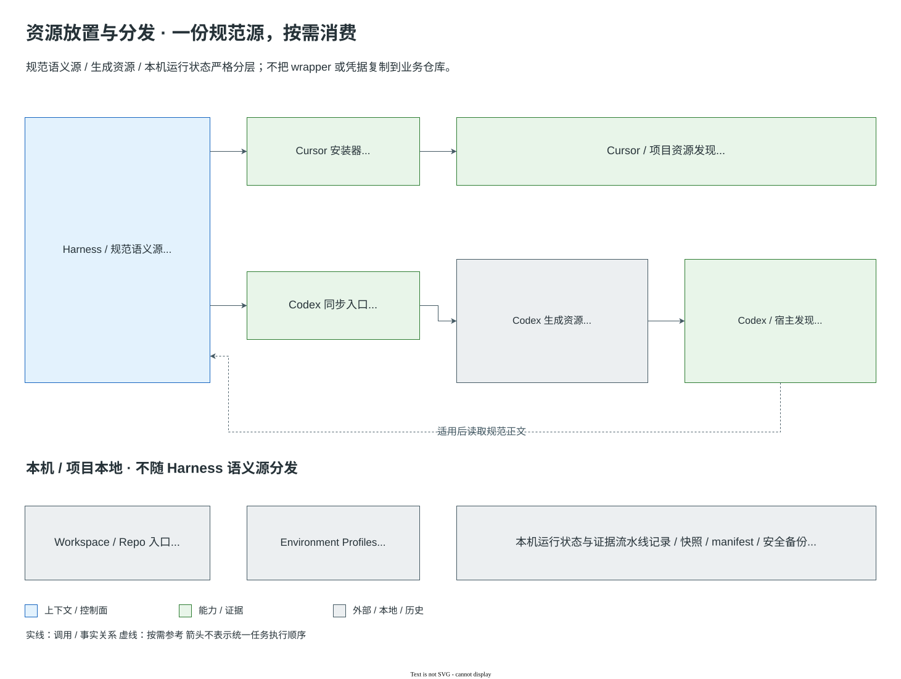
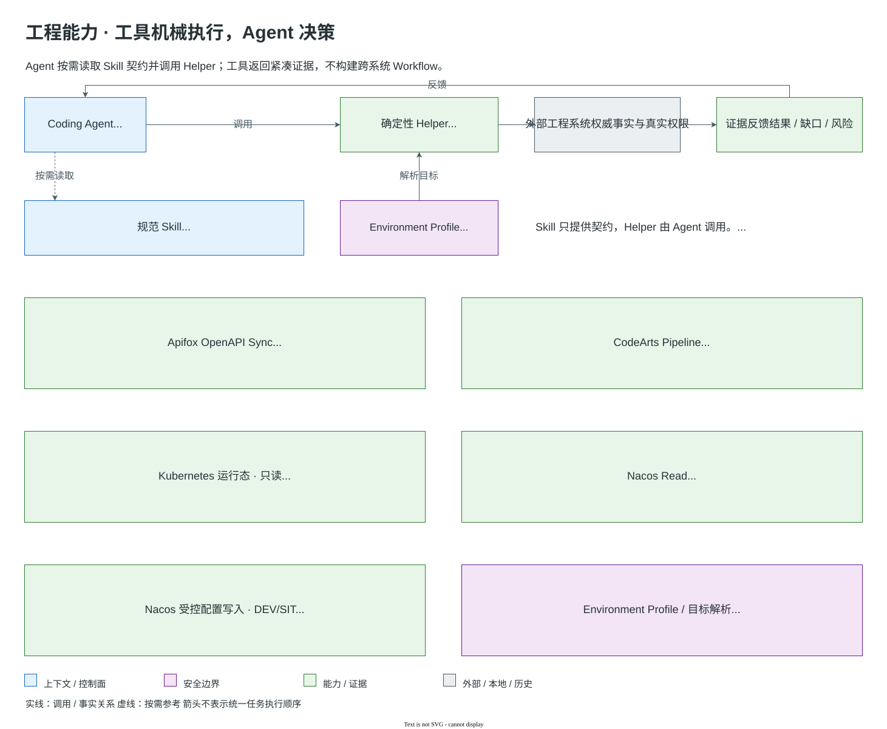

# Harness v3 架构

本文描述 Harness v3 的现行架构。README 负责快速入门；本文解释控制面（control plane）、运行模型、
上下文、质量协议、制品、分发与可移植性边界。

按三个层次阅读；这是文档导航，不是任务执行顺序：

| 层次 | 关注点 | 阅读入口 |
|---|---|---|
| What | Harness 是什么，谁掌握控制面 | [设计目标](#1-设计目标)、[控制面反转](#2-控制面反转) |
| How | 资源如何发现、能力如何调用、证据如何反馈 | [运行模型](#3-运行模型)、[资源模型](#4-资源模型)、[上下文](#5-上下文与渐进披露)、[验证](#6-审查与验证模型)、[分发](#9-分发架构)、[外部能力](#10-mcp-与外部能力) |
| Governance | 资源放置、安全、持久状态与持续维护 | [资源放置指南](resource-placement-guide.md)、[制品](#7-制品模型)、[安全](#8-安全与授权)、[生成资源生命周期](#11-生成资源生命周期)、[可移植性](#12-已知可移植性边界) |

## 1. 设计目标

Harness v3 的目标不是模拟完整软件组织，而是为强 Coding Agent 提供可靠的 AI Engineering Environment。

设计原则：

1. **模型智能优于提示词编排**：行动选择属于当前 Coding Agent。
2. **确定性工具优于模拟角色**：能由工具检查的事实不交给 AI 角色猜测。
3. **运行时证据优于生成文档**：仓库、Git、测试、扫描器、外部工程系统和运行环境是可信事实来源。
4. **渐进披露（progressive disclosure）**：默认上下文小，资源按任务和路径发现。
5. **简单默认路径 + 按需升级**：普通任务直接完成，高风险任务才升级专项审查和持久状态。
6. **外部能力不等于模型认知**：必要的工程上下文、权限边界、外部能力与验证机制不能仅因模型能力增强而取消；具体接入方式（CLI、MCP、API）应根据可靠性、执行成本和适用场景选择。

非目标：

- 不规定统一的模型推理步骤。
- 不把 Workflow 建成运行时状态机。
- 不按岗位拆分需求、架构、设计、计划和实施。
- 不要求每个任务生成过程 Markdown。
- 不把 MCP 配置、业务运行时或生产权限收进 Harness 仓库。



总体图承担 System Context 概览职责：用户交付目标与授权，Codex / Cursor 中的 Coding Agent 选择行动；
Harness 提供上下文、Guardrails、Capabilities 和 Validation；Workspace / Repositories 与外部工程系统提供事实。
Validation 表达证据检查契约，不负责重规划或求助；这些决策由 Coding Agent 作出。Rule / Hook 约束操作，不授予外部平台权限。
本机 Environment Profile 和运行证据不属于 Git 中的规范语义源。
这是参考 [C4 System Context](https://c4model.com/diagrams/system-context) 分层思想的职责视图，而非部署拓扑：
图中的 Rule、Skill、Helper 和验证契约不是独立部署容器，Harness 也不是第二决策控制面。
全部图示的可编辑源、实现依据、旧图盘点和维护方法见 [架构图索引](../image/architecture/README.md)。

## 2. 控制面反转

v3 的根本变化是控制面反转：



左侧仅为历史对照；右侧显示当前 Agent 按需消费知识和工具。箭头不是必经阶段，完成条件来自证据契约。

Coding Agent 可以按任务需要进行理解、调查、设计、计划、实施、审查准备或验证，
但这些是能力，不是必须按序经过的阶段。Playbook 只保存稳定的意图、少量建议、
可选能力、完成契约与升级条件。

选择下一行动时，Coding Agent 综合考虑信息增益、成本、风险、可逆性、成功概率、已有证据和外部依赖。
同类尝试的信息增益持续下降、外部前置条件缺失或原计划前提失效时，应 `REPLAN`；人工操作明显更便宜、
更可靠时可以 `ASK_HUMAN`。这是一项成本感知策略，不使用固定失败次数构造新的 Workflow。

因此普通任务不存在：

- 固定 phase；
- `next` / `transition`；
- author Agent handoff；
- 入口/出口制品令牌；
- workflow-state 驱动恢复；
- AI 设计或实现裁决 Gate。

## 3. 运行模型

Harness 的实际运行由宿主发现机制、Hooks、当前 Agent 和外部工具共同组成：



这是关系与反馈的示例，不是固定 Phase。资源发现、工具调用、重规划和人工协作都由 Coding Agent 按当前事实选择。

上述宿主发现机制与 Harness 资源 / Hook 是仓库文件、Hook、适配器、Rule 和工具入口组成的工程环境，
不是独立服务，也不进入业务应用运行时。

### Cursor Hook

- `sessionStart` 清理过期 Hook 状态，不注入额外正文。
- `beforeSubmitPrompt` 对编码意图生成简短 Rule 路径索引，不注入 Rule 正文。
- `preToolUse` 对写入和命令执行做确定性安全检查，并在自身故障时关闭放行。

Hook 是辅助发现和纵深防御，不是 Workflow 运行时。Codex 通过生成索引和 Skill wrapper 发现资源，
不会解释 YAML 为执行引擎。
当前 Codex Adapter 不安装或执行上述 Cursor Hook；两宿主共享使用契约，不共享同一命令拦截机制。

### 只读与代码变更路径

只读调查返回事实、结论和不确定性，不要求代码审查、最终验证或制品。
发生代码修改时，完成契约要求一组针对当前变更的证据：适用的机械验证、至少一个对应当前 diff 且 fresh 的独立只读综合审查结果、
按实际风险进行的 Security / Data-Concurrency 专项审查，以及确定性判定。每项证据需要关联 repo、branch、
HEAD 或 diff fingerprint、类型、结果、适用性和 freshness。实际调查、编辑、审查和验证顺序由 Coding Agent
根据价值和证据决定；契约只判断证据是否充分，不检查是否走完预定义流水线。

## 4. 资源模型

当前资源清单由文件系统和综合资源校验机械生成；架构不把快照数量当作长期契约。

| 资源类型 | 保存内容 | 加载方式 | 不应保存 |
|---|---|---|---|
| Rule | 稳定事实、约束、安全、权限、项目知识 | always-apply、globs 或按需发现 | 长篇方法、角色过程、临时结论 |
| Skill | 复杂、可复用、可选的方法或工具操作流程 | 任务语义命中时读取 | 简短提醒、默认 Workflow 路由 |
| Agent | 独立证据源、权限边界或专项隔离契约 | 默认审查或真实风险/外部事实触发 | 为模拟岗位而拆出的认知阶段 |
| Playbook | 意图、少量指导、可选能力、完成条件、升级条件 | Agent 按需参考 | steps、phase、transition、文件门禁 |
| Template | 持久状态、外部合同或审计证据结构 | 制品级别 / 外部生命周期要求时 | 每阶段过程记录、推理草稿 |
| Script / Helper | 确定性工程操作、外部系统调用、资源同步与验证 | Coding Agent、人或宿主明确调用 | 工程决策控制面、Workflow 运行时、AI 注册表 |

### Agents

- `integrated-reviewer`：代码变更完成时必须有至少一个 current-diff fresh 独立综合审查结果；相关代码变化使结果 stale 时允许按需重新审查。
- `security-reviewer`、`data-concurrency-reviewer`：只在实际风险命中时使用。
- `issue-context-fetcher`：整理用户已经提供的缺陷上下文。`log-investigator`：在 Loki 可用时获取受限、可追溯日志事实。
- `memory-consolidator`：只处理已经人工批准的 Rule 固化候选。

### Skills

Skill 默认可选；`done-verify` 同时承担代码变更完成契约中基于当前变更的最终验证。
发布到飞书等外部写入 Skill 仍要求显式授权。资源存在不表示自动执行或自动注入。
Coding Agent 决定使用何种能力；Skill 提供使用契约，Script/Helper 执行具体操作并返回结果，不替 Agent 选择业务目标或决定任务完成。

### Rules

只有 `.cursor/rules/execution-boundary.mdc` 为 `alwaysApply: true`。其他 Rule 依赖作用域、globs、
Rule 发现机制或 Coding Agent 的明确选择。

## 5. 上下文与渐进披露

### 默认上下文

最小默认上下文只包含一条执行边界，覆盖范围、授权、环境、危险操作、凭证和真实验证。
其实际数量与大小由 Context Budget 校验，不作为架构文档中的手工快照维护。

### Rule 发现

`beforeSubmitPrompt` 调用规范 rules engine：

1. 从 prompt 与相关文件路径识别可能场景。
2. 返回 `[Harness Rule Discovery]` 路径索引。
3. 明确说明索引未注入 Rule 正文。
4. Coding Agent 根据实际变更进一步缩小读取范围。

Rule frontmatter `globs` 可让宿主在高精度文件匹配时附加正文。Context Budget 限制自动附加数量和
总字符数，并禁止 broad `**/*.java` globs。

### 项目知识作用域

项目 Rule 位于 `.cursor/rules/projects/{project}/`，通过实际仓库路径隔离：

- Broker Rule 只对 Broker 作用域生效。
- Yunshang Rule 只对 Yunshang 作用域生效。
- B2C Rule 只对 B2C 作用域生效。
- 通用 Rule 不复制项目专属事实。
- 同一请求命中多个技术领域时可以合并候选，但不能因此加载另一个项目的知识。

### 校验边界

Context Budget 验证 Harness 自己控制的 always-apply 正文、glob 正文和发现消息；
IDE 内建上下文、用户级/团队级 Rule 以及用户明确加载的 Skill/Playbook 不属于该指标。

## 6. 审查与验证模型

### 机械验证

编译、测试、Lint、Schema、覆盖率、scanner、Git diff 和运行时工具提供客观事实。Harness 不允许：

- 用 AI 语言模拟工具 PASS；
- 手工修改 build output 冒充源码修复；
- 为通过验收而弱化 test/lint/scanner/suppression/exclusion；
- 复用与当前 diff 不一致的旧验证结果。

### Evidence Contract 与 freshness

完成判断先把 Task Contract 的硬验收条件映射到所需证据，再检查完整性、适用性与 freshness：

- Review 未修改代码或配置时，针对同一 diff 已通过的机械证据保持 fresh；
- 后续变更只使覆盖该变化的证据 stale，不相关证据继续有效；
- 只补齐或重跑缺失、失败、stale 且适用的检查；
- 外部环境、权限或人工操作导致硬证据暂时不可得时，返回可恢复等待或 `HUMAN_REQUIRED`，不能伪造 `PASS`。

### 审查拓扑

| 场景 | Integrated | Security | Data/Concurrency | 完成所需 fresh review evidence 类型数 |
|---|---:|---:|---:|---:|
| Normal | 1 | 0 | 0 | 1 |
| Security risk | 1 | 1 | 0 | 2 |
| Data/Concurrency risk | 1 | 0 | 1 | 2 |
| Both | 1 | 1 | 1 | 3 |

综合审查不重复 compiler、linter 或 scanner，也不执行完整专项审查。所有已触发专项审查
必须返回终态；不存在额外 AI 聚合裁决层。

### 确定性决策

Decision 只允许：

- `PASS`
- `CHANGES_REQUIRED`
- `HUMAN_REQUIRED`

当前 diff 导致适用于 Task Contract 硬验收的 required mechanical evidence `FAIL`、未解决代码/审查 BLOCKER，
或必需的 current-diff Review evidence 缺失/stale → `CHANGES_REQUIRED`。
硬验收证据因外部环境、权限或基础设施不可取得 → `HUMAN_REQUIRED` 或可恢复 waiting state。
已确认与当前 diff 无关且不阻塞硬验收的 baseline failure 保留 WARNING 和 unverified disclosure，
不自动要求修改当前代码。否则存在未解决授权/高风险或专项审查要求人工处理 → `HUMAN_REQUIRED`。
其余为 `PASS`，但仍需保留 WARNING、ADVISORY 与未验证范围。

### 基于当前变更的完成判定

修复审查发现后，受影响的机械证据和审查必须更新；没有修改代码或配置的 Review 不使已有证据自动 stale。
只有当前变更所需证据完整、适用且 fresh，确定性 Decision 才能为 `PASS`。制品级别不能降低该证据要求。

## 7. 制品模型

制品用于保存会离开当前上下文的未来状态：跨会话恢复、多人交接、审批、迁移、回滚或审计。
修改多个文件或模块本身不要求升级 L2；当前会话、仓库与工具证据足够且无需持久状态时，仍可按 L1 完成。
确有持久化需要并选择 L2 后，最小制品仍为 `task.md`；下表不改变既有等级契约。

| 级别 | 必需 | 按需 |
|---|---|---|
| L0 | none | none |
| L1 | none | 用户明确要求时可保存最终摘要 |
| L2 | `task.md` | 实际需要的设计或证据引用 |
| L3 | `task.md`, `verification.md` | `design.md` |
| L4 | `task.md`, `verification.md` | `design.md`, `migration.md`、审批、回滚、专项审查证据 |

L0/L1 不创建 task directory、phase index、decision log、debug bookkeeping 或空 archive。
L2+ 活动文件按需进入 `docs/artifacts/work/{task-id}/`。归档只移动实际存在的持久文件，
且必须发生在 evidence contract 达到 `PASS` 之后。

`task.md` 可以保存 `ACTIVE`、`WAITING_FOR_HUMAN`、`WAITING_FOR_EXTERNAL`、`DONE` 状态，以及
一个或多个 repo、branch、HEAD、diff resume anchors、阻塞事实、owner、恢复条件和证据缺口。`Next Options` 只是恢复后
重新评估的候选动作，不是 transition。历史制品是事实参考，不是当前执行令牌；恢复工作必须重新建立
当前仓库、Git 和工具事实。

## 8. 安全与授权

安全边界由 Rule、Hook、平台权限和人工授权共同形成，不依赖 Workflow 拓扑。



图中 Nacos 写入闭环是单个能力的安全契约，不是所有任务的执行顺序。未知目标和缺失授权不能靠重试绕过；
实际写入即使失败或部分成功，也需披露读回状态和安全记录。配置发布不等于应用已经加载。

### 常驻约束

- 只在用户指定项目和范围内操作。
- 明确只读时不得写入。
- 不擅自 commit、push、deploy、修改权限或写外部系统。
- 不硬编码、记录或提交密码、Token、密钥和真实用户敏感数据。
- 未执行或失败的验证必须如实报告。

### 确定性工具前置保护

Cursor 在启用 Harness Hook 时，`preToolUse` 允许普通 DEV/SIT 开发，阻断明确只读写入、PRE/PROD mutation、常见破坏性 Git、
递归强制删除和危险 SQL。它只是一层安全兜底，不代表所有命令都安全，也不授予新权限。
Codex 的命令执行边界取决于宿主实际配置的沙箱、审批与网络策略，以及 Helper 自身的目标和授权检查；
同步 Adapter 或通过 Cursor Safety Guard 测试，不代表 Codex 已获得相同拦截保障。宿主机制参见 [OpenAI 官方安全说明](https://learn.chatgpt.com/docs/agent-approvals-security)。

### 人工确认点

以下情况必须停止并获得具体授权：

- PRE/PROD 写入或部署；
- 不可逆或破坏性 DB/文件/Git 操作；
- 高风险迁移、回滚或灰度发布；
- 关键业务、资金、权限、安全、合规或组织审批歧义；
- materially 超出原任务的范围。

### Human as Capability

除 Mandatory Human Gate 外，Coding Agent 还可以把人视为协作能力：当阻塞主要来自环境、权限或外部系统，
继续自动尝试的信息增益下降，而人工操作明显更便宜、更可靠时，执行 `ASK_HUMAN`。请求必须说明需要人做什么、
为何更合适、Agent 已完成什么、可观察的完成信号，以及恢复后准备继续什么。任务进入可恢复的
`WAITING_FOR_HUMAN`，不会因此被视为完成，也不会获得额外授权。
当根因类别已高置信收敛到本机配置、凭证、服务路由或组织约定，人工可低成本补齐关键事实，且继续调查已不太可能改变下一行动时，应在扩大到相邻系统前优先 `ASK_HUMAN`。若仍有能区分竞争假设、验证关键安全边界或直接解决问题的有界高信息增益探针，则保持自主排查。

## 9. 分发架构

团队统一管理、跨项目复用的 Harness 工程能力，以 `.cursor` 与 `docs/templates` 为规范语义源。



这些团队资源的规范正文只在 Harness 维护；Cursor 使用链接，Codex 使用生成索引和薄 wrapper。本机 Profile、凭据引用和运行状态不随规范资源分发。
个人或第三方 Skill 保留各自来源与所有权，业务应用专属实现仍由业务仓库维护；不因可被 Agent 调用就自动归入 Harness。

### Cursor

使用原生 `.cursor` 布局与 Cursor Hook JSON。`link-cursor-config.sh/.ps1` 将 Harness 管理的
集合链接到业务项目，同时让 `docs/artifacts/work` 与 `archive` 保持项目本地。

### Codex

Harness 仓库根目录的 `sync-codex.sh` 是正式、可移植启动脚本；它只解析自身所在仓库、调用
`.cursor/scripts/sync-codex.mjs` 并透明转发参数。规范 Node 实现为当前 Skill 确定性生成短发现索引、
AGENTS 适配器和薄 wrapper。

默认输出固定在 `$CODEX_HOME/harness/zfnjjs`（未设置 `CODEX_HOME` 时为 `~/.codex/harness/zfnjjs`），
发现链接位于 `$CODEX_HOME/skills/<canonical-skill-name>`。公开 capability identity 与 `.cursor/skills` 目录名一致；
稳定 ownership identity `zfnjjs-harness` 和 storage namespace `zfnjjs` 只属于 Adapter 层，不进入 capability name。

历史或个人 AI workspace 中的 launcher 可以作为兼容 shim 调用 repo-local launcher，但不是 Harness 的依赖。

适配器在变更前执行所有权与路径边界预检，只清理自身可证明拥有的资源；
不会按名称或旧 `zfnjjs-*` 前缀盲目删除，也不会改写个人 MCP、IDE 配置或外部 Skill。同名用户 Skill
使同步 fail closed；旧 owner `zfnjjs-harness-v2` 仅在确定性 wrapper/config 与 symlink target 全部匹配时迁移。

## 10. MCP 与外部能力

MCP 配置保持 project-managed / host-managed。Harness 仓库中没有 MCP 运行时配置；
`.cursor/rules/mcp.mdc` 只定义命名、能力、引用和安全指引。

Harness 不强制依赖 MCP。长期稳定的是 Capability Contract，而不是接入协议；CLI、MCP、API 可以在保持能力、权限与证据契约的前提下替换。
Nacos 的失效 MCP 退役后由共享 CLI/Helper 承接，是接入方式的演进，不是取消 Nacos 能力。



图中列出当前工具化入口及其证据边界，不表示所有任务都要调用所有工具。Kubernetes Helper 当前只读。
Skill 是供 Coding Agent 按需读取的能力契约，Helper 由 Agent 调用；Environment Profile 只提供本机目标绑定，不选择工具，也不表示所有环境均已接通。
Pipeline Run `COMPLETED` 表示 Run 终态，不代表目标构建或部署 Job 已执行；目标 Job 可能仍为 `UNSELECTED`。
Run 的 `SUCCESS` 结果也不能代替目标 Job 的实际执行证据。部署成功必须确认目标 Job 实际执行且成功、构建产物与镜像版本，
以及 Kubernetes Deployment/Pod Ready、observed generation 和运行态收敛；这些证据仍不等于业务功能验证通过。
Nacos Read/Write 共用客户端与 Environment Profile；Write 支持 CREATE / UPDATE / APPEND，不开放 DELETE。
经明确授权的 `kubectl` 修改属于独立外部写操作，不由只读 Helper 承担；查询权限不自动授予变更权限。
Nacos Write 受 DEV/SIT Profile 和显式授权约束，写前备份、发布前复核指纹，单次发布后读回并披露实际变更。
其保守的 YAML/Properties 结构支持与非原子并发风险见 [Nacos Write 能力契约](../.cursor/skills/nacos-config-write/SKILL.md)；
不能把两次读取当成原子 CAS，也不自动重启应用。架构图不声明测试或真实 E2E 的验收结论。

当前可发现能力包括：

- Loki/LogQL 日志；
- Nacos 配置与服务发现；
- Swagger/Apifox API 契约；
- DB/MySQL/Redis/ES 数据层；
- CodeGraph 调用链与影响分析；
- CodeArts Pipeline / KooCLI 的租户隔离 DEV 构建与部署；
- Feishu 发布和浏览器自动化。

MCP 不可用时，可在同一能力和权限契约内选择 CLI/API；所需能力或证据仍不可得时如实报告缺口，不猜测外部事实。
是否允许读写、环境级别以及认证方式由当前项目、宿主和用户授权决定。

CodeArts Pipeline 的操作与授权语义只有 `.cursor/skills/codearts-pipeline/SKILL.md` 一份规范源；
项目 Rule 只提供平台路由；本机 Environment Profile 绑定当前 Pipeline 与 Kubernetes 目标，缺失或漂移时不回退旧环境。本机 KooCLI profile 管理凭证和 Project ID，
Harness 不保存 Secret，也不以 Agent、Playbook 或默认 Rule 建立部署 Workflow。
`.cursor/scripts/codearts-pipeline.mjs` 是 Skill 下的确定性操作层：从实时 Pipeline metadata 生成执行范围，
完成 Run/status/watch/failure-evidence 并返回紧凑 JSON；它不选择业务 Job，不自动 Retry/Stop，也不承担 DEV 自测。
完成契约由用户意图决定：`deploy-only` 需取得远端 source/revision、目标 Job 实际执行成功、构建产物/镜像关联与最小运行态收敛证据；只有明确要求自测、
功能验证或回归时才采用 `deploy-and-verify`，执行与当前变更匹配的功能级验证。该选择仍属于 Coding Agent，不进入 helper 或 Workflow。
飞书 Pipeline 通知保持人类通知通道，机器状态仍以 CodeArts API 与 `pipeline_run_id` 为事实来源。

## 11. 生成资源生命周期

### 修改规范源

修改 Harness 管理的平台无关 Agent、Skill、Playbook 或 Rule 时，只编辑 `.cursor` 规范源；不接管个人、第三方或业务应用专属资源。

### 同步

```bash
bash ./sync-codex.sh
```

Codex wrapper 带 generator、owner 与规范源 realpath 标识。
生成资源不能手工维护。

### 验证

`check-resource-consolidation.mjs` 核对规范资源与 Codex 生成索引，解析所有 repo-local index target，
验证 wrapper 所有权、断裂引用、过期资源与 MCP 外部管理模式。
`test-resource-adapters.mjs` 在隔离目录验证符号链接越界、外部所有权、完整预检和重复同步。

## 12. 已知可移植性边界

- Bash link 脚本用于 macOS/Linux；Windows 使用 PowerShell 脚本。macOS 上未执行 PowerShell 不能证明 Windows runtime 已验证。
- Cursor Hook schema 与 Codex 发现机制不同，因此宿主集成不能强行单源。
- 符号链接、junction、hardlink 能力取决于操作系统和本地权限。
- Codex 正式启动脚本与规范 Node 实现都位于 Harness 仓库；外部 workspace 入口仅可作为兼容 shim。
- MCP server、凭证与环境连通性不由 Harness 校验在运行时验证。
- CodeGraph 索引属于业务仓库本地状态，不随 Harness 分发。
- IDE 内建上下文、个人 Rule 和团队级配置不在 Harness Context Budget 的可控范围内。

## 延伸阅读

- [使用指南](usage-guide.md)
- [资源放置指南](resource-placement-guide.md)
- [制品协议](artifact-protocol.md)
- [v2 → v3 迁移指南](v2-to-v3.md)
- [资源整合决策](decisions/2026-09-15-resource-consolidation.md)
