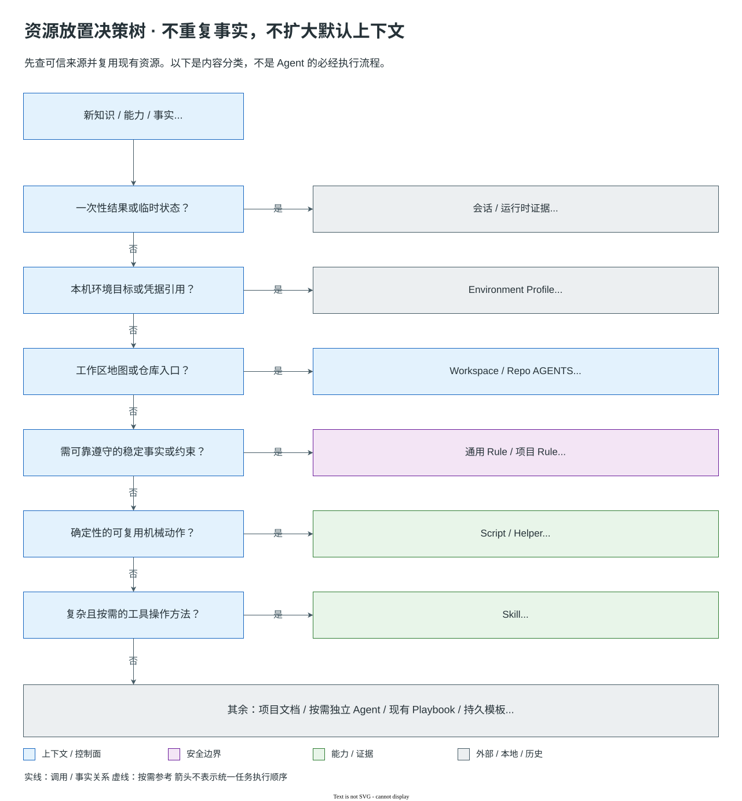

# Harness v3 资源放置指南

本文用于判断一项新知识或能力应该放在哪里。目标是保持单一语义源、最小默认上下文，
并避免为了提醒模型“怎么思考”而增加资源。

## 0. 能力从 Harness 产生

团队统一管理、跨项目复用的工程 Skill、Rule 和确定性 Agent 工具以 Harness v3 为唯一规范源。业务仓库消费这些能力，并保留业务应用专属实现、项目运行配置和任务制品。
个人或第三方 Skill 保留各自来源与所有权，不因可被 Agent 调用就必须迁入 Harness，也不由 Adapter 接管。

从真实业务任务长出需要团队统一维护的跨项目能力时：分类资源，在 Harness 实现、校验，通过现有 adapter 分发；不要在业务 `tools/` 中重复维护这类能力。业务应用专属实现不受此迁移要求约束。

## 1. 先判断是否需要 Harness 资源

新增前依次检查：

1. 这是稳定、可泛化的内容，还是当前任务的一次性事实？一次性事实留在会话或制品。
2. 仓库、项目文档、工具或外部系统是否已经保存它？已有可信事实不复制进提示词资源。
3. 能否扩展现有同类资源？能扩展就不新建。
4. 它是否必须自动生效？大多数内容应按需发现，而不是 always-apply。
5. 它是否在替 Coding Agent 规定推理步骤或模拟岗位？如果是，通常不应成为资源。



图中按内容职责分类：规则与项目事实进入规范源，机械操作由 Helper 实现，工具方法由 Skill 描述，
环境绑定和凭据引用留在本机 Profile，任务结果保留事实来源。Workspace AGENTS 只负责项目入口。
独立 Agent、Playbook 和持久模板仍按下文的真实契约与消费者判断，不为分类对称而新增资源。
可编辑源与更新方法见 [架构图索引](../image/architecture/README.md)。

Rule 不是知识 Wiki：只有需要 Coding Agent 在匹配任务中可靠遵守的稳定事实或约束才进入 Rule；
面向人的背景、解释和长篇知识进入项目文档。

| 示例 | 放置位置 |
|---|---|
| Broker 包结构约束 | Rule |
| 系统化调试方法 | Skill |
| 独立安全审查 | Agent |
| Bugfix 完成指导 | 自适应 Playbook |
| 迁移与回滚的持久证据 | 模板 / 制品 |

## 2. 规范源与分发

Harness 管理的平台无关正文只维护一份：

| 资源类型 | 规范位置 | 分发方式 |
|---|---|---|
| Agent | `.cursor/agents/{name}.md` | Cursor 原生；Codex 发现索引 |
| Skill | `.cursor/skills/{name}/SKILL.md` | Codex 薄 wrapper |
| Playbook | `.cursor/workflows/{name}.yaml` | Codex 发现索引；无运行时引擎 |
| Rule | `.cursor/rules/**/*.mdc` | Cursor 原生 |
| 路由库 | `.cursor/hooks/lib/rules-engine.mjs` | Cursor Hook |
| 宿主集成 | 各平台 `hooks.json`、Hook 输出、session-title | 宿主特定实现 |
| 持久模板 | `docs/templates/` | 只在真实持久状态或外部契约中使用 |
| 架构/决策 | `docs/` | 当前架构事实或稳定决策 |
| 临时审计/备份 | `.agent-work/` 或外部 scratch | 永不进入活跃发现范围 |

不要创建第二套手工维护的 Codex 语义正文，也不要为“单一来源”引入新的 registry、DSL、
overlay 或模板生成框架。

## 3. Rule

### 适合放 Rule

- 稳定的企业编码约束、权限边界、安全要求或验证要求。
- 确定的项目/领域事实，例如包结构、RPC、MQ、持久化和错误码约定。
- 在匹配任务或文件中应持续生效，并能给出明确的适用范围。
- 模型单靠通用能力无法可靠推导，或错误会带来现实风险。

### 不适合放 Rule

- 一次性需求、当前 Issue 事实、临时设计结论。
- 详细的多步操作方法；这通常属于 Skill。
- “先分析、再设计、再计划”这类固定思维步骤。
- 已由 compiler、linter、schema 或 CI 精确表达且无需补充权限语义的内容。
- 为防漏读而把所有项目知识设为 always-apply。

### 生效方式

- `alwaysApply` 只用于真正所有任务都需要的最小边界；当前唯一常驻 Rule 是 execution boundary。
- 技术 Rule 使用准确 globs 或 Rule 发现机制。
- 项目 Rule 放在 `.cursor/rules/projects/{project}/`，通过路径作用域隔离。
- 新增通用路由场景时同步 `rules-loader.mdc` 与规范 rules engine，并运行路由同步。
- 项目 Rule 不进入通用分类表，不得导致跨项目污染。

## 4. Skill

### 适合放 Skill

- 复杂、可复用、按需加载的 HOW。
- 真实工具操作流程，包含前置条件、权限、验证和失败处理。
- 需要稳定方法才能减少操作错误，例如 worktree、发布、复杂调试或最终验证。
- 有多个实际消费者，或一个长期稳定的高价值场景。

### 不适合放 Skill

- 一两句话即可表达的提醒。
- 纯岗位人格或“如何像某角色思考”。
- 与 Coding Agent 原生分析、设计、计划能力重复的固定步骤。
- 只为了与某 Agent 或 Playbook 一一配对。
- 默认路由、全局状态或 Workflow 引擎。

### 契约

Skill 应说明触发场景、前置条件、操作边界、证据、停止条件和禁止事项。
外部写入 Skill 必须保留明确授权要求。Skill 默认可选；若属于完成契约，例如 `done-verify`，
也仍应基于当前变更和真实工具证据运行，而不是创建固定制品。

## 5. Agent

只有满足至少一项独立价值时才考虑 Agent：

1. **独立证据源**：需要独立访问 Loki 等事实源并返回可追溯证据。
2. **独立权限边界**：读写权限、生产数据、外部发布或治理权限必须隔离。
3. **专项隔离价值**：安全或数据并发等高风险审查需要独立上下文和只读契约。
4. **独立审查**：实现者不能自己宣布审查通过，需要明确的只读审查者。

Agent 必须具有可独立调度的 `WHO + WHAT + CONTRACT`，包括输入、输出、权限、完成标准和停止条件。

不要为以下内容创建 Agent：

- 需求理解、问题分析、架构思考、详细设计、实现计划、编码等模型认知阶段；
- 仅为制造“多人委员会”而拆分的通用代码质量维度；
- 没有独立工具、权限、证据或上下文价值的岗位名称；
- orchestrator、workflow-manager、router 或 AI arbitration gate。

## 6. 自适应 Playbook

Playbook 适合保存：

- 明确意图；
- 少量有用的默认指导；
- 可选 Skill、Agent 与工具；
- 代码变更完成契约；
- 真实风险与人工授权升级条件；
- 渐进式制品策略。

Playbook 不得包含：

- 固定 `steps`、phase、`next`、transition；
- author Agent 链；
- entry/exit 文件门禁；
- L0/L1 持久状态；
- design/implementation AI Gate；
- 自动执行运行时或全局注册表。

当前只保留 `bugfix`、`refactoring`、`feature-delivery` 三个稳定意图。新的任务类型优先由 Coding Agent
组合现有资源处理；只有长期重复且完成/升级契约明显不同，才考虑新增 Playbook。

## 7. 模板与制品

只有以下原因才值得持久化：

- 未来状态需要跨会话恢复；
- 多人、多仓或多 Agent 交接；
- 外部审批、发布或审计；
- 迁移、回滚或独立执行脚本；
- 用户明确要求长期文档。

不应持久化：

- 模型推理草稿；
- 为阶段对称产生的 Markdown；
- Git、CI、测试、扫描器已经保存的完整输出副本；
- L0/L1 的状态、当前阶段、决策日志、调试记录；
- 空目录或只复制模板的归档。

优先合并到 `task.md`、`design.md`、`verification.md`、`migration.md` 四个核心文件。
独立子模板必须有当前消费者或明确的 L4/外部用途，并登记在 `docs/templates/README.md`。

## 8. 项目文档与 Rule 的边界

适合放项目文档：

- 面向人的背景、概念解释、长篇架构说明和入门内容；
- 不要求在每个匹配任务中自动生效的知识；
- 需要大图、教程、决策背景或历史上下文的材料。

适合放 Rule：

- Coding Agent 在具体任务中必须遵守的稳定事实或约束；
- 能定义清晰作用域、触发条件与可验证结果；
- 内容足够短，适合按需加载。

长篇文档可以成为 Rule 的事实来源，但不要把全文复制进 Rule。Rule 应引用稳定位置并提炼可执行约束。

## 9. Script / Hook

Script/Helper 执行确定性操作：通用实现放在 `.cursor/scripts/`，专属实现可随所属 Skill 保存，包括：

- 确定性工程操作及外部系统调用，例如配置查询、受控写入、构建执行和有界状态观察；
- 资源同步 / 链接 / 安装；
- schema、引用、数量与漂移校验；
- 上下文、安全、审查、制品与 Workflow 回归；
- 隔离适配器测试。

Coding Agent 负责目标与行动选择，Skill 提供使用契约，Script/Helper 执行具体操作并返回证据；工具不接管工程判断。
Hook 只适合宿主事件集成、短上下文发现和确定性安全检查；当前 `preToolUse` 拦截属于 Cursor 集成，不由 Codex 适配器自动提供。
禁止在 Script/Hook 中建立 Workflow 运行时、模型行动注册表或持久阶段状态。

## 10. 修改流程

修改 Harness 资源时：

1. 读取 `.cursor/AGENTS.md` 和 `harness-resource-authoring`。
2. 搜索同名、同义资源及所有直接引用。
3. 选择最小资源类型；需要模板时读取对应 authoring reference。
4. 只修改规范源；宿主特定契约除外。
5. 同步直接引用、文档和验证器中的真实预期。
6. 运行综合资源校验；涉及适配器时追加适配器测试。
7. 检查 git diff，确认没有生成资源漂移、断裂链接或无关修改。

常用命令：

```bash
bash .cursor/scripts/check-harness-resources.sh
node .cursor/scripts/check-resource-consolidation.mjs
node .cursor/scripts/test-resource-adapters.mjs
git diff --check
```

## 11. 审查清单

- [ ] 新内容确实长期稳定，且没有现成可信事实可直接引用。
- [ ] 没有创建模拟认知阶段或岗位的 Agent。
- [ ] Skill 具有复杂、可复用、按需的方法价值。
- [ ] Rule 作用域准确，没有扩大 always-apply 或跨项目污染。
- [ ] Playbook 没有固定阶段、转换、交接或制品门禁。
- [ ] Template 有持久/外部消费者，不服务 L0/L1 流程完整性。
- [ ] 平台无关正文只改规范源。
- [ ] 直接引用、生成资源和文档链接全部可解析。
- [ ] 上下文、安全、审查、制品与 Workflow Diet 没有回归。

## 12. 停止条件

遇到以下情况停止新增并重新判断：

- 与现有资源职责重叠，无法形成清晰独立边界；
- 需要新注册表、overlay、别名或生成器框架才能成立；
- 只是为了提醒模型执行通用推理动作；
- Rule 候选没有用户批准却要求直接固化；
- 会未经授权改变业务代码、外部系统、用户资源或历史归档；
- 无法说明资源的真实消费者、作用域或验证方法。

相关文档：[架构](architecture.md) · [使用指南](usage-guide.md) · [制品协议](artifact-protocol.md) · [模板索引](templates/README.md)
